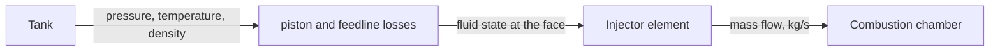
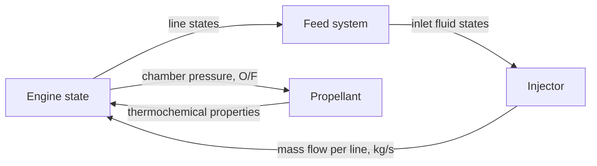

# Feed Systems

The feed system in a liquid or hybrid rocket engine delivers propellants from their storage tanks to the injector.
Machwave models it as a set of propellant lines, one per propellant.
The feed system therefore does not depend on the number of propellants, and the same architecture serves hybrid, monoliquid, biliquid and triliquid engines.

## Propellant Lines

A propellant line has three attributes:

1. **Name**: identifies the line across the whole simulation.
2. **Role**: the part the propellant plays in the mixture (oxidizer, fuel or additive).
3. **Tank**: the tank the line drains from.

The feed system holds its lines keyed by name and works on all of them at once: it receives the state of every line and returns a result for every line.
A cycle is defined by how it pressurizes its lines, not by how many lines it has.

The names join the models together.
The injector holds one element per line name, and the simulation records mass, mass flow rate, tank pressure and tank temperature per line name.
A line added to the feed system appears at the injector face and in the results without any of them depending on an order.

The roles are what the physics reads.
Flows are summed by role instead of dividing one line by another, so the mixture ratio keeps its meaning at any propellant count and an additive line can flow without entering it.

## The Injector Face

The feed system owns everything upstream of the injector face: tank state, feedline pressure drop, the piston in a stacked-tank cycle, and in the future a pump discharge or a regenerative jacket outlet.
The injector owns the orifice.

What passes between them is the fluid state at the face: fluid name, pressure, temperature and density.
That is the whole interface, so the injector never sees a tank.

## Solving Every Line Together

The feed system takes the state of every line and returns the injector inlet state of every line in a single call.

The lines are solved together because they can be coupled.
In a stacked-tank cycle the fuel is pressurized by the oxidizer ullage through a piston, so the fuel inlet pressure depends on the oxidizer state.
Solving each line separately would mean passing every other line's state in as an argument, which grows with the square of the propellant count.

The state each line contributes is its fluid mass and, for a tank running an energy balance, its internal energy.
These are the variables the integrator carries between timesteps.

## Pressure-Fed Cycles

### Stacked Tanks

In a stacked-tank cycle the tanks sit in a vertical stack.
The tank at the top, the **pressurizing line**, sets the pressure of the whole system and drives every tank below it through a piston.

For a line $i$:

$$
P_{\text{inlet},i} = P_{\text{tank},p} - \delta_{i \neq p}\, \Delta P_{\text{piston}} - \Delta P_{\text{line},i}
$$

where:

- $P_{\text{tank},p}$ is the pressure of the pressurizing line's tank [Pa]
- $\Delta P_{\text{piston}}$ is the pressure loss across the piston [Pa], applied to every line below the top of the stack
- $\Delta P_{\text{line},i}$ is the pressure loss along the line's feedline [Pa]

The feedline loss is **given at the design flow**, not computed from the instantaneous flow and the line geometry.

### Single Line

The single-line cycle is the one-line case:

$$
P_\text{inlet} = P_\text{tank} - \Delta P_\text{line}
$$

The tank pressurizes itself.
A self-pressurized propellant such as nitrous oxide is driven by its own vapor pressure while liquid remains, then blows down on the real-gas equation of state once the liquid is gone.
An empty tank has zero pressure, which stops the flow at the injector element.

This is the arrangement of an oxidizer-only hybrid feed and of a monoliquid engine.

## The Orifice

An injector element is a discharge coefficient, a flow area and a mass flow model.
It depends only on its own inlet state and the chamber pressure, and delivers no flow once the chamber pressure reaches the inlet pressure (backflow is not modeled).

The **single-phase incompressible** (SPI) orifice equation applies to a subcooled liquid:

$$
\dot{m} = C_d\, A\, \sqrt{2 \rho \left(P_\text{inlet} - P_0\right)}
$$

The **homogeneous equilibrium model** (HEM) applies to a self-pressurized propellant whose liquid flashes across the orifice and can choke at the two-phase speed of sound:

$$
\dot{m} = C_d\, A\, G_\text{HEM}
$$

where:

- $C_d$ is the discharge coefficient [-]
- $A$ is the orifice flow area [m²]
- $\rho$ is the liquid density at the inlet [kg/m³]
- $P_0$ is the chamber pressure [Pa]
- $G_\text{HEM}$ is the homogeneous equilibrium mass flux [kg/(m²·s)]

## Coupling with the Chamber

Each timestep, the inlet state of every line is read once.
The injector is then evaluated at each chamber pressure the Runge–Kutta solver tries.
No line can deliver more than the mass it has left over the timestep.

The **mixture ratio** (O/F) is the total oxidizer flow over the total fuel flow, summed by line role:

$$
\text{O/F} = \frac{\sum_{i \in \text{oxidizer}} \dot{m}_i}{\sum_{j \in \text{fuel}} \dot{m}_j}
$$

An additive line is not part of either sum.
A monoliquid has no oxidizer flow and therefore no mixture ratio, so its propellant is evaluated at its own formulation.

A tank running an **energy balance** carries its internal energy as a second state variable.
Draining removes the enthalpy of the fluid that left:

$$
U_{n+1} = U_n - \Delta m\, h_\text{out}
$$

The remaining liquid boils to refill the ullage and cools as it does, so the saturation pressure drops over the burn instead of staying constant until the liquid runs out.

## Propellant Count

| Lines | Engine | Cycle |
| --- | --- | --- |
| 1 | Hybrid motor (oxidizer only), monoliquid engine | Single line |
| 2 | Biliquid engine | Stacked tanks |
| 3 | Triliquid engine, with a diluent or coolant line | Stacked tanks |

The feed system, the injector and the recorded results work at every count.
Evaluating the thermochemistry of a three-propellant mixture is a separate problem: the thermochemical service is built around one oxidizer card and one fuel card, so a third stream has to be blended into one of them with a weight split before CEA can evaluate it.

## Implementation

A line is a [`PropellantLine`][machwave.models.feed_systems.lines.PropellantLine], with its role given by [`ComponentRole`][machwave.models.propellants.components.ComponentRole] and its tank by [`Tank`][machwave.models.feed_systems.tank.Tank].
The state each line contributes per timestep is a [`LineState`][machwave.models.feed_systems.lines.LineState], and the state at the injector face is a [`FluidState`][machwave.common.fluid_state.FluidState].

Every cycle derives from [`FeedSystem`][machwave.models.feed_systems.base.FeedSystem].
[`get_inlet_states`][machwave.models.feed_systems.base.FeedSystem.get_inlet_states] solves every line in one call; a concrete cycle implements only [`get_inlet_pressures`][machwave.models.feed_systems.base.FeedSystem.get_inlet_pressures], and the base class builds the fluid states from the tanks.
The two cycles are [`StackedTankPressureFedFeedSystem`][machwave.models.feed_systems.cycles.StackedTankPressureFedFeedSystem] and [`SingleLinePressureFedFeedSystem`][machwave.models.feed_systems.cycles.SingleLinePressureFedFeedSystem].
Self-pressurization, blowdown and the energy balance are handled by [`Tank.get_pressure`][machwave.models.feed_systems.tank.Tank.get_pressure].

The orifice is an [`InjectorElement`][machwave.models.thrust_chamber.injector.InjectorElement], and an [`Injector`][machwave.models.thrust_chamber.injector.Injector] holds one element per line name.
[`get_mass_flows`][machwave.models.thrust_chamber.injector.Injector.get_mass_flows] returns the flow of every line at a given chamber pressure.

The coupling with the chamber happens in [`BiliquidEngineState.run_timestep`][machwave.simulation.biliquid.states.BiliquidEngineState.run_timestep].

# References

- Sutton, G. P. & Biblarz, O., *Rocket Propulsion Elements*, 9th ed., Wiley, 2017. Sections 6.3 and 10.2.
- Whitmore, S. A. & Chandler, S. N., "Engineering Model for Self-Pressurizing Saturated-N2O-Propellant Feed Systems", *Journal of Propulsion and Power*, Vol. 26, No. 4, 2010.
