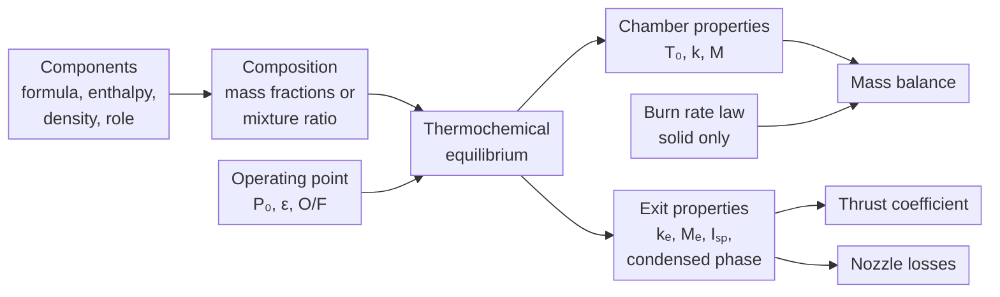

# Propellants

The propellant model supplies two inputs to the simulation loop: the thermochemical properties of the combustion products, used by the [mass balance](mass_balance.md) and the [thrust coefficient](thrust.md), and, for solid propellants, the burn rate.
The properties come from a chemical equilibrium calculation on the propellant composition; the burn rate is an empirical fit.

## Composition

A propellant is a set of components, each defined by its chemical formula, standard enthalpy of formation [J/mol], initial temperature [K] and density [kg/m$^3$].
Each component has a role (oxidizer, fuel or additive), used only for validation and for assigning feed lines in a biliquid engine; the equilibrium calculation sees the elemental composition and enthalpy only.

A **solid** propellant has a fixed composition, given by mass fractions $w_i$.
A **biliquid** propellant is defined by its oxidizer, its fuel and the mixture ratio $O/F = \dot{m}_{ox} / \dot{m}_{fuel}$, which can vary during the burn (see [Mixture Ratio](#mixture-ratio)).

!!! example "KNSB"
    Most examples on this page use KNSB, 65% KNO$_3$ and 35% sorbitol (C$_6$H$_{14}$O$_6$) by mass, with densities of 2110 and 1490 kg/m$^3$.

## Density

The theoretical maximum density (TMD) of a solid mixture is the mass-weighted harmonic mean of the component densities, assuming no voids:

$$
\rho_{TMD} = \left(\sum_i \frac{w_i}{\rho_i}\right)^{-1}
$$

For KNSB, $\rho_{TMD} \approx 1842\ \text{kg/m}^3$.

Porosity and casting voids are accounted for by the density ratio $f \in (0, 1]$, defined per grain segment:

$$
\rho_p = f\,\rho_{TMD}, \qquad \dot{m}_{in} = \rho_p\, r\, A_b
$$

Voids reduce mass only; they do not affect burn area or burn rate.

For biliquid engines, propellant density comes from the tank fluid state computed by the feed system.

## Thermochemical Equilibrium

Machwave evaluates the combustion products with NASA CEA (Gordon & McBride 1994): adiabatic, constant-pressure combustion to the Gibbs free energy minimum, followed by isentropic expansion to the expansion ratio $\varepsilon$.
The inputs are the chamber pressure $P_0$, $\varepsilon$ and, for biliquids, $O/F$.
Since the properties depend on $P_0$ (mainly through dissociation), they are evaluated at every timestep.

| Property | Symbol | Description |
|---|---|---|
| Adiabatic flame temperature | $T_0$ | Chamber temperature [K] |
| Chamber isentropic exponent | $k$ | |
| Chamber molecular weight | $M$ | [kg/mol] |
| Exhaust isentropic exponent | $k_e$ | Frozen expansion |
| Exhaust molecular weight | $M_e$ | Frozen expansion [kg/mol] |
| Frozen specific impulse | $I_{sp,\,frozen}$ | [s] |
| Shifting specific impulse | $I_{sp,\,shifting}$ | [s] |
| Chamber condensed mass fraction | $\xi$ | |
| Exhaust condensed mass fraction | $\xi_e$ | |

The specific gas constant is $R = R_u / M$.

The ratio $I_{sp,\,frozen} / I_{sp,\,shifting}$ bounds the effect of finite-rate recombination in the nozzle and drives the kinetics loss.
The condensed fractions drive the two-phase flow loss; KNSB, for example, has $\xi_e \approx 0.32$ (potassium salts).
Propellants made only of H, C, N, O, halogens and noble gases cannot form condensed species at chamber conditions, so this query is skipped for them.

### Fixed Properties

A solid propellant can instead carry a fixed property set, used for every chamber pressure.
This removes the CEA dependency and run time cost, at the expense of the pressure dependence, which is small for most solids.
The bundled solid formulations use fixed properties.
Biliquid propellants are always evaluated, since the properties depend on $O/F$.

## Chamber and Exhaust Properties

$k$ and $M$ are given at two stations because the composition and temperature change through the expansion.
Each equation uses the station it describes:

| Property | Station | Used in |
|---|---|---|
| $T_0$ | Chamber | Mass balance, scaled by the combustion efficiency |
| $k$ | Chamber | Nozzle flow function, critical pressure ratio, loss-of-choking stop criterion |
| $M$ ($R$) | Chamber | Mass balance |
| $k_e$ | Exit | Exit pressure, flow separation, ideal thrust coefficient |
| $M_e$ | Exit | Not used by the current models |
| $I_{sp,\,frozen}$, $I_{sp,\,shifting}$ | Nozzle | Kinetics loss |
| $\xi$ | Chamber | Two-phase flow loss |

The nozzle mass flow is evaluated at the throat, where $P/P_0 \approx 0.58$ and the gas is still close to its chamber state.
The thrust coefficient integrates the full expansion ($P_e/P_0 \approx 1/40$ at $\varepsilon = 8$), so it uses the exit values.
For KNSB ($k = 1.136$, $k_e = 1.042$) at 5 MPa, $\varepsilon = 8$ and sea level, using $k$ instead of $k_e$ lowers the ideal $C_F$ from 1.651 to 1.587 (−4%).

## Burn Rate

The burn rate follows Saint Robert's law:

$$
r = a P_0^n
$$

(Seidel 1965, Eq. 2)

with $r$ in mm/s and $P_0$ in MPa, following the usual convention for published propellant data.

$a$ and $n$ are fitted to strand burner or static fire data and are given as a burn rate map: a list of pressure ranges, each with its own coefficients.
Pressures outside the map raise an error; the fits are not extrapolated.

*Bundled burn rate maps of KNDX and KNSB (Nakka). The shaded bands are the five pressure ranges of KNDX.*

KNDX shows a plateau ($n \approx 0$) between about 0.8 and 2.6 MPa.
Adjacent ranges are fitted independently, so the burn rate can be slightly discontinuous at the boundaries.

## Mixture Ratio

The nominal $O/F$ of a biliquid propellant is a design value.
At every timestep, Machwave evaluates the properties at the actual $O/F$, computed from the injector mass flows; if either flow is zero, it falls back to the nominal value.

!!! example "LOX/LH2 at 5 MPa and $\varepsilon = 40$"
    | $O/F$ | $T_0$ [K] | $M$ [g/mol] | $I_{sp,\,shifting}$ [s] |
    |---|---|---|---|
    | 4 | 2935 | 10.0 | 454 |
    | 5 | 3259 | 11.8 | 455 |
    | 6 | 3447 | 13.4 | 451 |
    | 7 | 3532 | 14.8 | 444 |
    | 8 | 3546 | 16.1 | 431 |

    $T_0$ peaks near stoichiometric ($O/F \approx 7.9$), while $I_{sp}$ peaks fuel-rich due to the lower $M$.

The 1 kN N$_2$O/ethanol example engine, for instance, is designed for $O/F = 1.95$ but starts at about 1.66.

## Quantization and Caching

A CEA evaluation takes a few milliseconds, so results are cached.
To get cache hits, $P_0$ is rounded to 200 Pa and $O/F$ to 0.001 before the lookup; the key also includes $\varepsilon$.
The resulting error is negligible: for KNSB, $\partial T_0 / \partial P_0 \approx 7$ K/MPa, so 200 Pa amounts to about 0.001 K.

In the 1 kN biliquid example engine, about 31,000 timesteps require about 3,100 evaluations (about 7,100 without quantization).

The cache is stored on the propellant object and shared by every simulation that uses it.
Fixed properties bypass it.

## Implementation

Components are [`PropellantComponent`][machwave.models.propellants.PropellantComponent] instances with a [`ComponentRole`][machwave.models.propellants.ComponentRole].
Propellant classes derive from [`Propellant`][machwave.models.propellants.Propellant], one per [`MixtureType`][machwave.models.propellants.MixtureType]:

- [`SolidPropellant`][machwave.models.propellants.SolidPropellant]: mass fractions, burn rate map, optional fixed properties; provides `ideal_density` (TMD) and `get_burn_rate`.
- [`BiliquidPropellant`][machwave.models.propellants.BiliquidPropellant]: one oxidizer, one fuel and `oxidizer_to_fuel_ratio`.

`Propellant.evaluate` handles quantization and caching and returns a [`ThermochemicalProperties`][machwave.models.propellants.ThermochemicalProperties].
On a cache miss it calls the RocketCEA wrapper in `machwave.services.cea` (`cea` extra).

The density ratio is a parameter of [`GrainSegment`][machwave.models.grain.base.GrainSegment].
Bundled propellants are in [`formulations`][machwave.models.propellants.formulations], loaded with [`get_propellant_from_json`][machwave.models.propellants.formulations.base.get_propellant_from_json].

[`SolidMotorState`][machwave.simulation.solid.states.SolidMotorState] and [`BiliquidEngineState`][machwave.simulation.biliquid.states.BiliquidEngineState] evaluate the propellant once per timestep at the start-of-step chamber pressure.
The properties are held constant over the step, while the solid burn rate is re-evaluated at each Runge–Kutta stage.

# References

1. Gordon, S., & McBride, B. J. (1994). *Computer Program for Calculation of Complex Chemical Equilibrium Compositions and Applications. I. Analysis*. NASA Reference Publication 1311.
2. Seidel, H. H. (1965). *Transient Chamber Pressure and Thrust in Solid Rocket Motors*. Brown Engineering Company, Inc., Huntsville, AL (DTIC AD-613962).
3. Sutton, G. P., & Biblarz, O. (2001). *Rocket Propulsion Elements* (7th ed.). Wiley. Ch. 5 and 11.
4. Nakka, R. *Richard Nakka's Experimental Rocketry Web Site*. https://www.nakka-rocketry.net
