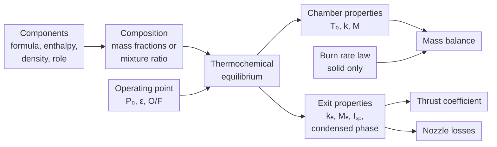
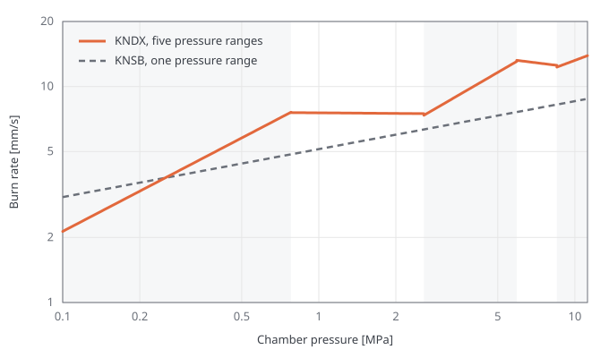

# Propellants

The propellant model supplies two things to the simulation loop.
The first is the burn rate (solid propellants only), which sets the mass inflow of the [mass balance](mass_balance.md).
The second is the set of thermochemical properties of the combustion products: flame temperature, molecular weight and isentropic exponent.
These appear in both the mass balance and the [thrust coefficient](thrust.md).

The thermochemical properties are computed from the chemical composition of the propellant with an equilibrium solver.
The burn rate is an empirical law fitted to measurements of the real propellant.

## Components

A propellant is a mixture of chemical components, each with one of three roles:

- **Oxidizer:** potassium nitrate (KNO$_3$), liquid oxygen, nitrous oxide.
- **Fuel:** sorbitol, ethanol, liquid hydrogen. Polymer binders such as HTPB are also classified as fuel.
- **Additive:** burn rate catalysts, opacifiers and other minor ingredients.

Each component is described by:

- **Chemical formula:** number of atoms of each element in one molecule.
- **Standard enthalpy of formation** [J/mol]: chemical energy stored in the molecule.
- **Initial temperature** [K]: temperature of the component before combustion. A cryogenic oxidizer enters the chamber with less energy than one stored at room temperature.
- **Density** [kg/m$^3$]: density of the pure component, used to compute the density of a solid propellant (see [Density](#density)).

The equilibrium calculation only uses the elements and the energy of the mixture, so the role of a component has no effect on the combustion products.
Roles are used to check that the mixture has at least one oxidizer and one fuel, and to assign each component to a feed line in a biliquid engine.

### Mixture Type

In a **solid** propellant, the components are premixed and cast or pressed into a grain.
The composition is set at manufacture by the mass fraction $w_i$ of each component, with $\sum_i w_i = 1$, and does not change during the burn.

In a **biliquid** propellant, the oxidizer and the fuel are stored in separate tanks and only mix in the combustion chamber.
The composition is given by the mixture ratio, the ratio of oxidizer to fuel mass flow:

$$
O/F = \frac{\dot{m}_{ox}}{\dot{m}_{fuel}}
$$

Since the two flows are set independently by the feed system, the mixture ratio can vary during the burn (see [Mixture Ratio](#mixture-ratio)).

!!! example "KNSB"
    KNSB is a common amateur propellant made of 65% potassium nitrate and 35% sorbitol by mass.
    The bundled formulation uses:

    | Component | Formula | Enthalpy of formation | Density |
    |---|---|---|---|
    | Potassium nitrate | KNO$_3$ | −494.6 kJ/mol | 2110 kg/m$^3$ |
    | Sorbitol | C$_6$H$_{14}$O$_6$ | −1356 kJ/mol | 1490 kg/m$^3$ |

    KNSB is used for most of the examples on this page.

## Density

Density is only needed for solid propellants, to convert grain volume into mass.
For a biliquid engine, propellant mass is tracked in the tanks and its density comes from the fluid state computed by the feed system.

### Theoretical Maximum Density

Consider a mass $m$ of a solid mixture.
Component $i$ has mass $w_i m$ and occupies a volume $w_i m / \rho_i$.
Assuming no voids, the component volumes add up, and the mixture density is:

$$
\rho_{TMD} = \frac{m}{\sum_i w_i m / \rho_i} = \left(\sum_i \frac{w_i}{\rho_i}\right)^{-1}
$$

where:

- $\rho_{TMD}$ is the theoretical maximum density of the mixture [kg/m$^3$]
- $w_i$ is the mass fraction of component $i$ (dimensionless)
- $\rho_i$ is the density of component $i$ [kg/m$^3$]

This is the mass-weighted harmonic mean of the component densities.
It is the upper limit for the density of the mixture, reached only by a void-free grain.

!!! example "KNSB"
    $$
    \rho_{TMD} = \left(\frac{0.65}{2110} + \frac{0.35}{1490}\right)^{-1} \approx 1842\ \text{kg/m}^3
    $$

    The arithmetic weighted mean, $0.65 \times 2110 + 0.35 \times 1490 \approx 1893\ \text{kg/m}^3$, is about 3% higher.

### Loaded Density

Real grains are less dense than the theoretical maximum.
Cast propellants trap air bubbles and shrink while cooling, and pressed propellants retain some porosity.
The density ratio $f$ accounts for this, giving the loaded density:

$$
\rho_p = f\,\rho_{TMD}, \qquad 0 < f \leq 1
$$

where:

- $\rho_p$ is the loaded propellant density [kg/m$^3$]
- $f$ is the density ratio (dimensionless)

In Machwave, the density ratio is defined per grain segment, since segments of the same propellant may be cast with different quality.
It scales the propellant mass of each segment and the mass generation rate in the [mass balance](mass_balance.md):

$$
\dot{m}_{in} = f\,\rho_{TMD}\, r\, A_b
$$

Voids are modeled as missing mass only, with no effect on burn area or burn rate $r$.
Highly porous grains, where the flame penetrates the pores and the burn rate increases, are not covered by this model.

## Thermochemical Equilibrium

During combustion, the atoms of the propellant recombine into a mixture of products such as water, carbon dioxide, carbon monoxide, hydrogen and nitrogen.
Some propellants also produce liquid or solid species.
The product composition is obtained by assuming chemical equilibrium.

For a given set of elements, enthalpy and chamber pressure, the equilibrium composition is the one that minimizes the Gibbs free energy.
Combustion is assumed adiabatic and at constant pressure, so the enthalpy of the products equals that of the reactants.
The solution gives the composition and temperature of the chamber gas.
This temperature is the adiabatic flame temperature $T_0$, and the composition gives the molecular weight $M$ and the isentropic exponent $k$.

The gas is then expanded through the nozzle up to the expansion ratio $\varepsilon$, which gives the state at the nozzle exit.

Machwave uses NASA's Chemical Equilibrium with Applications program (CEA) for this calculation (Gordon & McBride 1994).

### Inputs

- **Chamber pressure** $P_0$. Higher pressure reduces dissociation, which slightly raises the flame temperature.
- **Expansion ratio** $\varepsilon$, which defines the exit state.
- **Mixture ratio** $O/F$, for biliquid propellants only.

Since the chamber pressure varies during a burn, the properties are evaluated again at every timestep.

!!! example "KNSB"
    Evaluated with CEA at $\varepsilon = 8$, the adiabatic flame temperature of KNSB goes from about 1551 K at 1 MPa to about 1599 K at 8 MPa.

### Outputs

| Property | Symbol | Description |
|---|---|---|
| Adiabatic flame temperature | $T_0$ | Ideal temperature of the products in the chamber [K] |
| Chamber isentropic exponent | $k$ | Ratio of specific heats in the chamber |
| Chamber molecular weight | $M$ | Mean molar mass of the products in the chamber [kg/mol] |
| Exhaust isentropic exponent | $k_e$ | Ratio of specific heats at the nozzle exit |
| Exhaust molecular weight | $M_e$ | Mean molar mass of the products at the nozzle exit [kg/mol] |
| Frozen specific impulse | $I_{sp,\,frozen}$ | Ideal specific impulse with the composition fixed through the nozzle [s] |
| Shifting specific impulse | $I_{sp,\,shifting}$ | Ideal specific impulse with the composition in equilibrium through the nozzle [s] |
| Chamber condensed fraction | $\xi$ | Mass fraction of liquid or solid products in the chamber |
| Exhaust condensed fraction | $\xi_e$ | Mass fraction of liquid or solid products at the nozzle exit |

The specific gas constant used in the mass balance is obtained from the molecular weight:

$$
R = \frac{R_u}{M}
$$

where $R_u = 8.314\ \text{J/(mol-K)}$ is the universal gas constant.

### Frozen and Shifting Equilibrium

As the gas expands and cools in the nozzle, species dissociated in the chamber tend to recombine and release heat.
Two limiting cases are considered:

- **Shifting equilibrium:** reactions are infinitely fast and the composition stays in equilibrium along the nozzle. All the recombination heat is recovered, giving an upper bound on performance.
- **Frozen flow:** reactions are infinitely slow and the composition stays the same as in the chamber. No recombination heat is recovered, giving a lower bound.

Real nozzles fall in between, since the residence time of the gas in the nozzle is too short for the reactions to fully reach equilibrium.
The difference between $I_{sp,\,frozen}$ and $I_{sp,\,shifting}$ is used by the kinetics loss.
The exhaust isentropic exponent and molecular weight are taken from the frozen expansion.

### Condensed Phase

Some propellants produce liquid or solid particles in the exhaust, such as potassium carbonate from potassium nitrate propellants and aluminum oxide from aluminized propellants.
These particles do not expand like the gas and lag behind it as it accelerates through the nozzle, which reduces performance.
The condensed fractions $\xi$ and $\xi_e$ are used by the two-phase flow loss.

Propellants made only of hydrogen, carbon, nitrogen, oxygen, halogens and noble gases do not produce condensed species at chamber conditions, so Machwave skips this calculation for them.

!!! example "KNSB"
    About a third of the KNSB exhaust mass ($\xi_e \approx 0.32$) is condensed potassium salts, which contributes to its low ideal specific impulse of around 150 s.

### Fixed Properties

A solid propellant can also be defined with a fixed set of thermochemical properties, taken from a previous equilibrium calculation or from the literature.
In that case the same values are used for every chamber pressure throughout the burn.

Fixed properties do not require CEA, have no run time cost and match published data exactly.
On the other hand, they ignore the effect of chamber pressure on the flame temperature, exponents and molecular weights.
This effect is small for most solid propellants, and the bundled solid formulations use fixed properties.

Biliquid propellants are always evaluated with CEA, since the properties must follow the mixture ratio.

## Chamber and Exhaust Properties

The isentropic exponent and molecular weight are given separately for the chamber and for the nozzle exit.
Between the two stations the temperature drops by hundreds to thousands of kelvin, the composition can change, and condensed species can form or solidify, so the values differ.

Each equation uses the values of the station it describes:

| Property | Station | Used in |
|---|---|---|
| $T_0$ | Chamber | Flame temperature in the mass balance, after the combustion efficiency |
| $k$ | Chamber | Nozzle flow function and critical pressure ratio in the mass balance; loss-of-choking stop criterion |
| $M$, through $R$ | Chamber | Stored gas mass and nozzle mass flow in the mass balance |
| $k_e$ | Exit | Exit pressure, flow separation and ideal thrust coefficient |
| $M_e$ | Exit | Not used by the current models |
| $I_{sp,\,frozen}$, $I_{sp,\,shifting}$ | Whole nozzle | Kinetics loss |
| $\xi$ | Chamber | Two-phase flow loss |

The [mass balance](mass_balance.md) is written in terms of the chamber stagnation state, with the nozzle mass flow evaluated at the throat.
The pressure at the throat is roughly half the chamber pressure, so the gas there is still close to its chamber state.
Most of the expansion happens in the divergent section: at $\varepsilon = 8$, the exit pressure is about forty times lower than the chamber pressure.
The [thrust coefficient](thrust.md) depends on the full expansion to the exit, so it uses the exit values.

!!! example "KNSB"
    The bundled KNSB has $k = 1.136$ in the chamber and $k_e = 1.042$ at the exit.
    At 5 MPa, $\varepsilon = 8$ and sea level, the ideal thrust coefficient is 1.651 with $k_e$, and 1.587 with $k$, about 4% lower.

## Burn Rate

The burn rate $r$ of a solid propellant is the speed at which the burning surface regresses, normal to itself.
It depends mainly on chamber pressure and is modeled by Saint Robert's law:

$$
r = a P_0^n
$$

(Seidel 1965, Eq. 2)

where:

- $r$ is the burn rate [mm/s]
- $P_0$ is the chamber pressure [MPa]
- $a$ is the burn rate coefficient [mm/s/MPa$^n$]
- $n$ is the burn rate pressure exponent (dimensionless)

The coefficient $a$ is given for burn rate in mm/s and pressure in MPa, following the usual convention in published propellant data.

The burn rate cannot be derived from the composition.
It depends on the heat transfer from the flame to the propellant surface, which is affected by particle size, catalysts and the manufacturing process.
The coefficients $a$ and $n$ are fitted to experimental data, usually from strand burner tests or small static fires.

A single power law rarely fits the whole pressure range of a propellant, so the burn rate is given as a burn rate map: a list of pressure ranges, each with its own $a$ and $n$.
At each timestep, the coefficients are taken from the range that contains the current chamber pressure.

*Burn rate maps of KNDX and KNSB bundled with Machwave, based on data from Nakka. The shaded bands are the five pressure ranges of KNDX.*

KNSB uses a single range, while KNDX uses five.
Between about 0.8 and 2.6 MPa, the KNDX exponent is close to zero and the burn rate is nearly independent of pressure (a plateau).
Each range is fitted separately, so adjacent ranges may not match exactly at the boundary, which causes a small step in burn rate.

If the chamber pressure falls outside all ranges, Machwave raises an error instead of extrapolating the fit.

The burn rate is used in the mass inflow of the [mass balance](mass_balance.md), $\dot{m}_{in} = \rho_p r A_b$, and to advance the burning surface of the grain (see [Grain Regression](grain_regression.md)).

## Mixture Ratio

A biliquid propellant is defined with a nominal mixture ratio, the design value of $O/F$.
During operation, the actual mixture ratio is set by the feed system and the injector, and changes as tank pressures decay and injector pressure drops vary.

At every timestep, Machwave computes the mixture ratio from the oxidizer and fuel mass flows and evaluates the thermochemical properties at that value.
If either flow is zero, the nominal mixture ratio is used.

The mixture ratio has a large effect on the combustion products:

!!! example "LOX/LH2 at 5 MPa and $\varepsilon = 40$"
    | $O/F$ | $T_0$ [K] | $M$ [g/mol] | $I_{sp,\,shifting}$ [s] |
    |---|---|---|---|
    | 4 | 2935 | 10.0 | 454 |
    | 5 | 3259 | 11.8 | 455 |
    | 6 | 3447 | 13.4 | 451 |
    | 7 | 3532 | 14.8 | 444 |
    | 8 | 3546 | 16.1 | 431 |

    The flame temperature is highest near the stoichiometric ratio (about 7.9), while the specific impulse peaks on the fuel-rich side.
    Excess hydrogen lowers the molecular weight of the exhaust, and this increases the exhaust velocity more than the lower flame temperature reduces it.

For example, the 1 kN nitrous oxide/ethanol example engine is designed for $O/F = 1.95$, but its tanks and injector deliver about 1.66 at ignition.

## Quantization and Caching

Each equilibrium evaluation takes a few milliseconds, and a simulation can have tens of thousands of timesteps.
Since the properties vary slowly with the operating point, results are cached and reused between timesteps.

Chamber pressure is a continuous variable and almost never takes the exact same value twice, so the inputs are quantized before the cache lookup.
Chamber pressure is rounded to the nearest 200 Pa and mixture ratio to the nearest 0.001.
The cache key is formed by the rounded values and the expansion ratio, which is fixed by the nozzle.

The error from rounding is negligible.
For KNSB, the flame temperature changes by about 50 K between 1 and 8 MPa, so a 200 Pa step changes it by about 0.001 K.

!!! example "1 kN biliquid example engine"
    A run of about 31,000 timesteps requires about 3,100 equilibrium evaluations, compared with about 7,100 without quantization.

The cache is stored in the propellant object, so it is shared by all simulations that use the same propellant.
Solid propellants with fixed properties skip the cache entirely.

## Implementation

Components are instances of [`PropellantComponent`][machwave.models.propellants.PropellantComponent], with roles given by [`ComponentRole`][machwave.models.propellants.ComponentRole].

Each mixture type has its own propellant class, derived from [`Propellant`][machwave.models.propellants.Propellant]:

- [`SolidPropellant`][machwave.models.propellants.SolidPropellant] stores the mass fractions, the burn rate map and, optionally, fixed thermochemical properties. It computes the theoretical maximum density (`ideal_density`) and the burn rate (`get_burn_rate`).
- [`BiliquidPropellant`][machwave.models.propellants.BiliquidPropellant] stores one oxidizer, one fuel and the nominal mixture ratio (`oxidizer_to_fuel_ratio`).

Components are validated when the propellant is created.
The mixture type of each class is a [`MixtureType`][machwave.models.propellants.MixtureType], which other models use to check compatibility, for example to select the nozzle losses that apply to a motor.

`Propellant.evaluate` returns a [`ThermochemicalProperties`][machwave.models.propellants.ThermochemicalProperties] object holding the outputs listed in [Outputs](#outputs) and the derived specific gas constants.
The quantization and the cache are handled inside `evaluate`.
On a cache miss, it calls a RocketCEA wrapper in `machwave.services.cea`, created once per propellant, which requires the `cea` extra.

The density ratio is a parameter of each grain segment ([`GrainSegment`][machwave.models.grain.base.GrainSegment]).

Bundled propellants are available in [`formulations`][machwave.models.propellants.formulations] and are loaded from JSON files with [`get_propellant_from_json`][machwave.models.propellants.formulations.base.get_propellant_from_json].
The bundled solid formulations use fixed properties and do not require the `cea` extra.

During a run, [`SolidMotorState`][machwave.simulation.solid.states.SolidMotorState] and [`BiliquidEngineState`][machwave.simulation.biliquid.states.BiliquidEngineState] evaluate the propellant once per timestep, at the chamber pressure at the start of the step, and the biliquid state also passes the current mixture ratio.
The thermochemical properties are kept constant over the step, while the solid burn rate is evaluated again at each Runge–Kutta stage.

# References

1. Gordon, S., & McBride, B. J. (1994). *Computer Program for Calculation of Complex Chemical Equilibrium Compositions and Applications. I. Analysis*. NASA Reference Publication 1311.
2. Seidel, H. H. (1965). *Transient Chamber Pressure and Thrust in Solid Rocket Motors*. Brown Engineering Company, Inc., Huntsville, AL (DTIC AD-613962).
3. Sutton, G. P., & Biblarz, O. (2001). *Rocket Propulsion Elements* (7th ed.). Wiley. Ch. 5 and 11.
4. Nakka, R. *Richard Nakka's Experimental Rocketry Web Site*. https://www.nakka-rocketry.net
