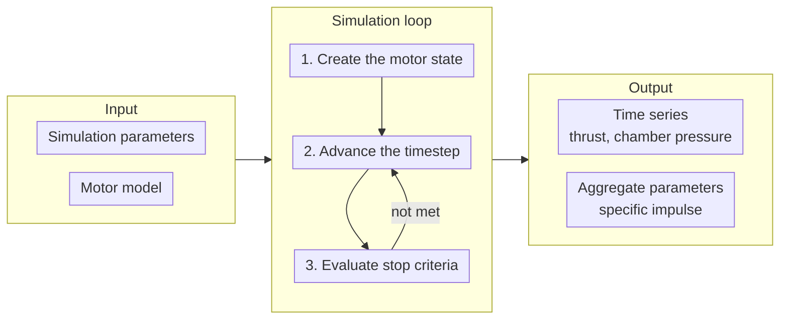

# The Simulation Loop

> A simulation is the imitation of the operation of a real-world process or system over time.

(Banks et al. 2001, p. 3)

Machwave's simulation loop takes a motor model plus a set of simulation parameters, iterates the motor state over time in fixed timesteps, and returns the time history of the run.

## Inputs

The **[`Motor`][machwave.models.motors.Motor] model** is the physical description of the motor/engine: propellant, grain, feed system, thrust chamber, and more.
By design, it does not change during a run and no simulation state is stored in it.

The **simulation parameters** ([`InternalBallisticsSimulationParams`][machwave.simulation.base.InternalBallisticsSimulationParams]) set the conditions of the run.
These parameters are common to every motor type, be it solid, biliquid, or other.
They are:

- **Timestep:** the fixed time interval between two state evaluations [s].
- **Igniter pressure:** the chamber pressure at the start of the run [Pa].
  The ignition transient is not modeled, so the run starts with the chamber already pressurized.
- **External pressure:** the ambient pressure, held constant for the whole run [Pa].
  The trajectory is not modeled, so altitude changes during the burn are not accounted for.

## The Simulation Class

The class [`InternalBallisticsSimulation`][machwave.simulation.base.InternalBallisticsSimulation] runs the loop shown above.
It creates the state class matching the motor type, advances it one timestep at a time until the state reports that the run is over, and returns the result.
It holds no physics and no stop logic of its own: the state decides both what a timestep computes and when the run ends.

### The State Class

The **motor state** is what changes during a run: the time, the chamber pressure the propellant properties, and more.
There is one state class per motor type, [`SolidMotorState`][machwave.simulation.solid.states.SolidMotorState], [`BiliquidEngineState`][machwave.simulation.biliquid.states.BiliquidEngineState], and so on, all extending [`MotorState`][machwave.simulation.states.MotorState].

Each timestep, the state evaluates the motor at the current chamber pressure, records the operating point, and advances to the next timestep.
It also decides when the run is over: once the stop criteria is met it sets `end_thrust` to `True`, and the simulation stops advancing.

### Stop Criteria

The **stop criteria** decide when the run is over.
They are evaluated by the state, not by the simulation. [`MotorState`][machwave.simulation.states.MotorState] checks them once per timestep, after the iteration is evaluated, and sets `end_thrust` to `True` once one is met.
Since the check lives in the base class, every motor type stops on the same criteria.

The run ends on the first of two conditions:

- **Loss of choking:** the chamber pressure falls below the external pressure divided by the critical pressure ratio.
- **Tail-off:** the motor has no propellant able to burn and the thrust has decayed to 0.1% of its peak.

## Outputs

The state is frozen into a [`SimulationResult`][machwave.simulation.results.SimulationResult] instance.
It contains time series such as thrust and chamber pressure, as well as aggregated metrics such as total impulse and specific impulse.
Every motor type extends the abstract class: [`SolidSimulationResult`][machwave.simulation.solid.results.SolidSimulationResult], [`BiliquidSimulationResult`][machwave.simulation.biliquid.results.BiliquidSimulationResult], and so on.

# References

1. Banks, J., Carson, J. S., Nelson, B. L., & Nicol, D. M. (2001). *Discrete-Event System Simulation* (3rd ed.). Prentice Hall.
